# Lance Commander – Battle for the Sphere

A free, non-commercial remake of MechCommander 2 (2001) in Godot 4.7, built on Microsoft's 2006 Shared Source
release of the game. You command a lance of up to twelve 'Mechs, plus support vehicles, through the original
24-mission campaign. It has modern graphics, a rewritten simulation and the heat system the original left
unfinished.

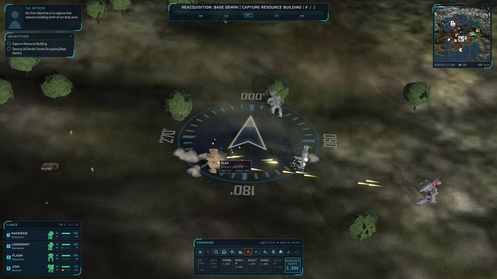

> **Status:** work in progress. The campaign loop, combat, AI and world rendering work end to end. Art is still
> being upgraded, and balance has not been tuned.

## What it is

MechCommander 2 was a real-time tactics game: no base building and no resource harvesting, just a small,
persistent unit of 'Mechs and MechWarriors carried from mission to mission. Microsoft released its source code,
tools and data in 2006 under a non-commercial licence. Lance Commander reads that data (maps, missions, mission
scripts, unit stats, pilots, textures and models), converts it with its own tools, and plays it in a new engine.

The remake's code is new. It is written in GDScript from a reading of the original C++, with each rule traced
to the original's source in comments and in [docs/specs/](docs/specs/). Where the original was unfinished,
compiled out or inconsistent, the specs say what the remake does instead and why.

## Features

### Campaign

- **All 24 missions** of the original campaign, in order.
- **Briefing:** a tactical map with numbered objective markers, the mission text and the tactical officer's
  notes.
- **Mech Bay:** deploy 'Mechs within the mission's drop weight and the 12-slot cap, assign pilots, sell reserve
  'Mechs and buy from the mission's purchase list.
- **Debrief:** objectives met or failed, the state of each lance member and enemy losses.
- **Salvage:** after a win, every disabled 'Mech on the field, your own included, can be bought back at 80% of
  its price.
- **MechWarriors** keep their skills, specialties and wounds between missions.

  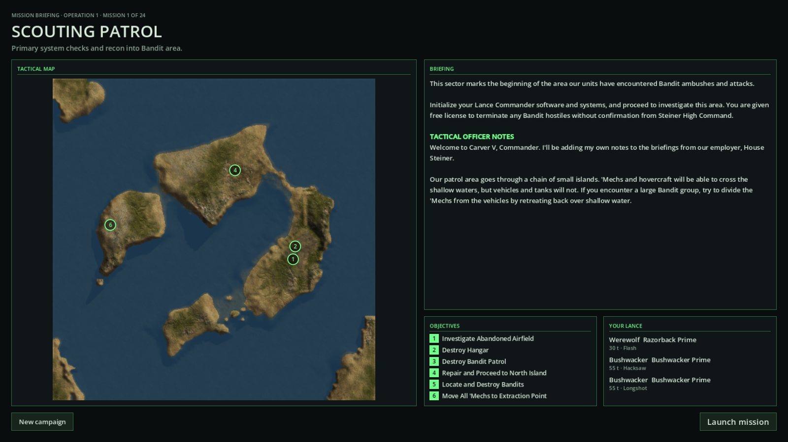
  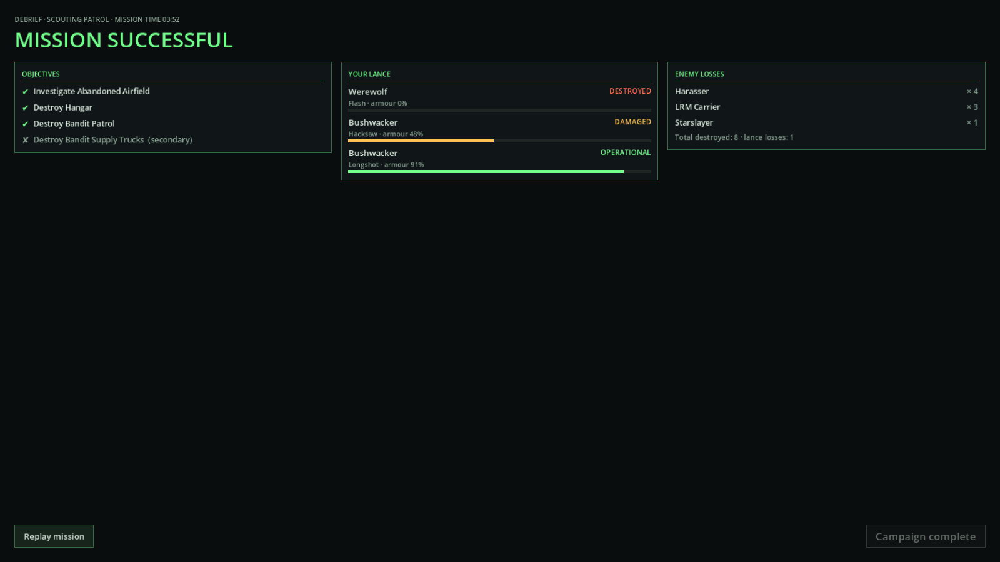

### Combat

- **A real-time tactics simulation** with selection by click, drag box or unit card. You can move, attack, and
  capture buildings, hold position, or fire an alpha strike.
- **Heat is back on.** The original's heat model was compiled out and unfinished. The remake completes it from
  the original's own tables, so weapons heat, heat sinks cool, and an overheating 'Mech shuts down.
- **Location-based damage:** a per-unit paper doll on the unit card shows armour and internal structure for each
  location.
- **Support powers** paid for with resource points: air strikes, sensor probes, repair trucks and salvage
  craft.
- **The original mission scripts and AI brains:** the remake has its own interpreter for ABL, MechCommander 2's
  scripting language. It runs the 2001 scripts for every mission's triggers, objectives, reinforcements and
  unit behaviour.
- **A minimap, objective markers and a comms window** for mission messages.

### World

The ground, sky, water and weather are drawn from each mission's own data the way the original drew it, then
built on with new detail. Notes on each step and the reasons for it are in
[docs/terrain-rendering.md](docs/terrain-rendering.md).

- **The painted colour map:** each mission's baked colour map is drawn unlit, as the original drew it. The sun
  follows the original's formula, so dynamic shadows fall in line with the painted ones.
- **Ground detail:** CC0 detail textures, triplanar grain on steep slopes, and an edge skirt so the map does
  not end at a cliff.
- **Roads, runways, bridges and cement pads** from the original overlay layer, upscaled.
- **Trees:** a high-detail forest drawn with MultiMesh, so thousands of trees per map are cheap.
- **Skies and fog:** a sky panorama per mission, mission fog colours, depth haze that follows the zoom, and
  height fog.
- **Water** with the mission's own depth colours and the original's animated sparkle.
- **Weather:** rain and lightning where the mission's data asks for them.
- **Ground marks:** each 'Mech leaves its own footprints, plus impact craters, scorch marks under wrecks, and a
  wake ring in water.

| | |
|---|---|
| 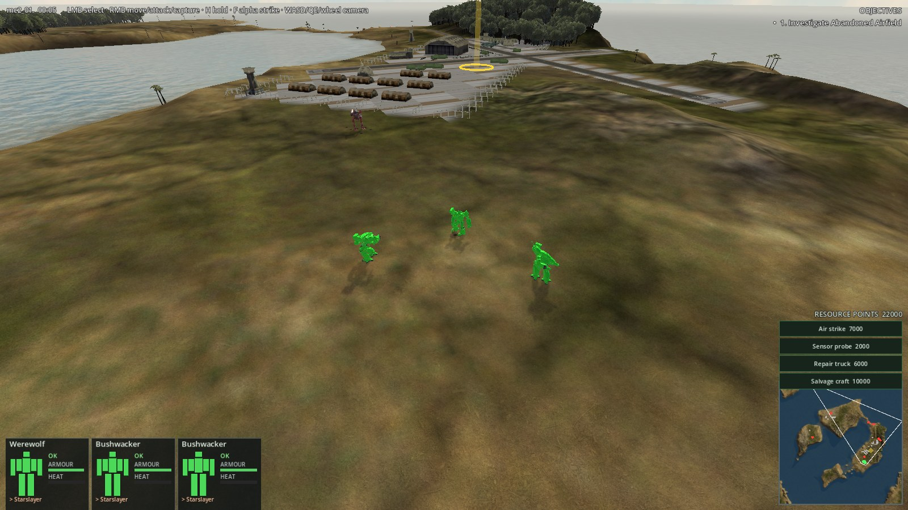 | 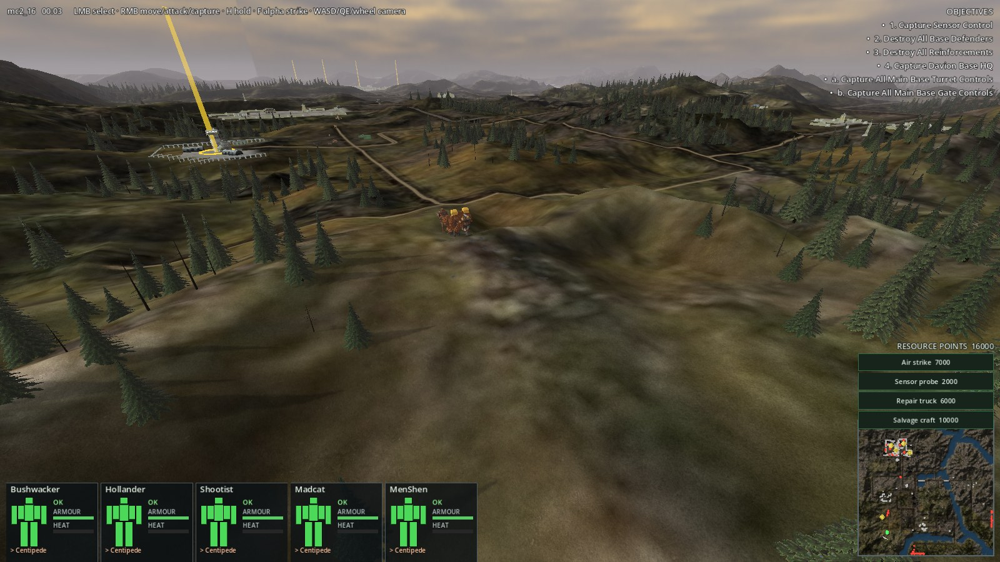 |
| *Mission 1: the abandoned airfield* | *Mission 16: forest and hills* |
| 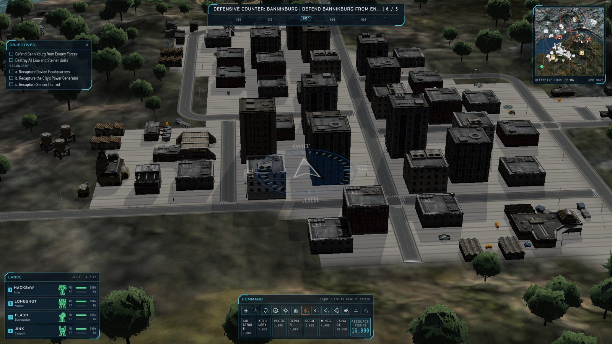 | 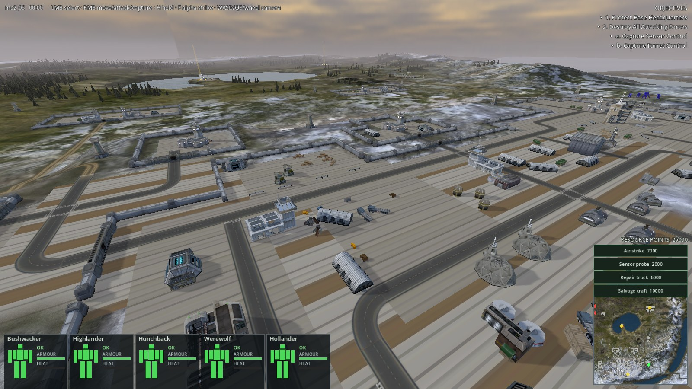 |
| *Mission 18: Bannikburg* | *Mission 6: base defence* |
| 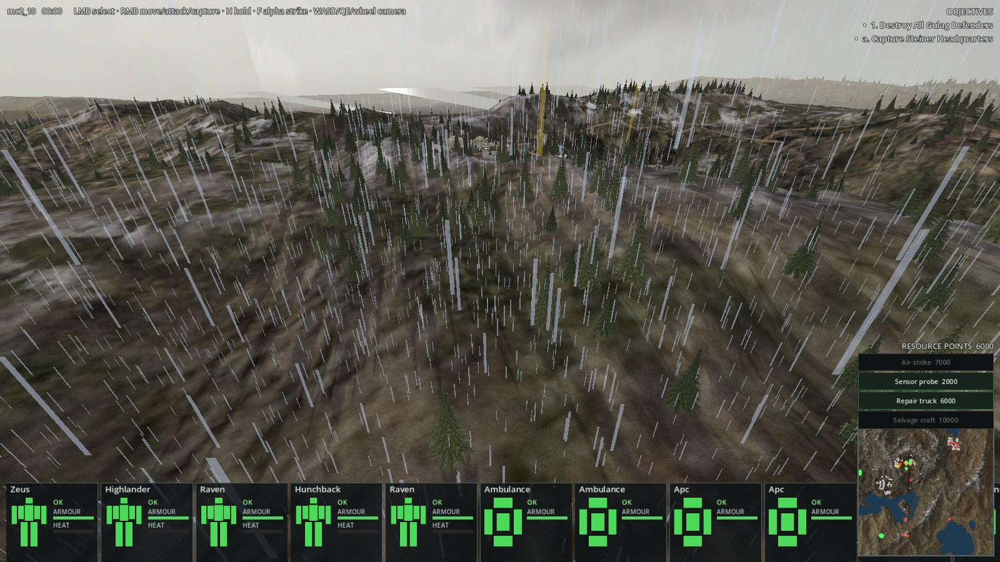 | 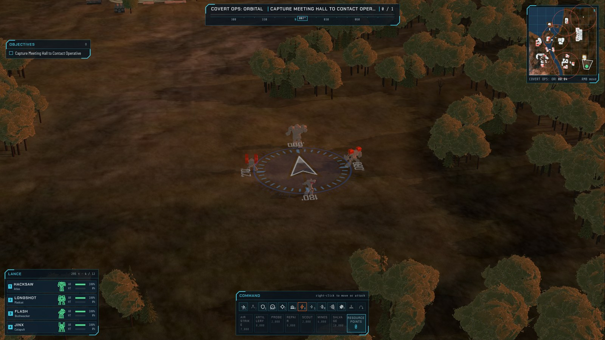 |
| *Mission 10: rain* | *Mission 14: autumn* |

### HD art

The original's models are low-polygon, with 128-pixel textures. The remake replaces them, keeps the originals
as a fallback, and records the provenance of every asset (see [docs/art-provenance.md](docs/art-provenance.md)).

- **'Mechs:** 30 HD 'Mechs. Most are adapted from 3D-printable miniatures shared under Creative Commons licences.
  Each sculpt is rigged onto the original 'Mech's skeleton, so it walks, turns its torso and dies with the
  original animations.
- **Vehicles:** 28 HD vehicles, copters and infantry, adapted the same way, with turrets mounted on the
  original's turret joints.
- **Paint:** every unit takes the original's three-channel team colour scheme.
- **Buildings:**
  - The original's buildings keep their geometry. Their textures are upscaled 4x with RealESRGAN.
  - Common buildings are being rebuilt as new parametric CAD models.

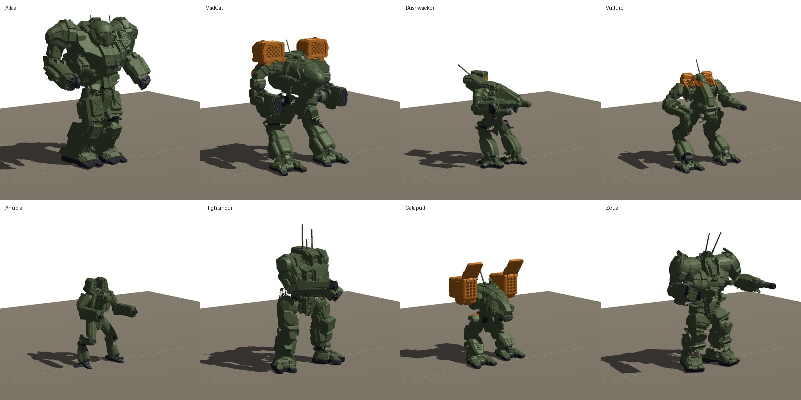

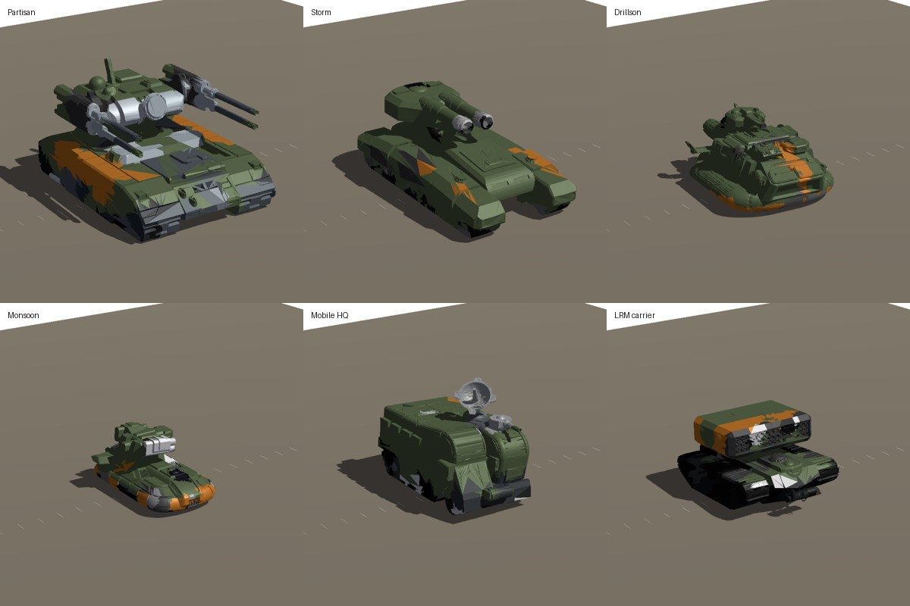

## Getting started

You need [Godot 4.7](https://godotengine.org/) and Python 3. The converted game data in `game/data/` and the
converted assets are in the repository, so the game runs from a fresh clone:

    godot --path game

The first launch imports the assets, which takes a few minutes.

**Controls:**

| Input | Action |
|---|---|
| Left-click, drag, or a unit card | Select units |
| Right-click | Move, attack a unit or building, or capture |
| H | Hold position |
| F | Alpha strike |
| WASD, Q/E, mouse wheel | Pan, rotate and zoom the camera |
| Click the minimap | Pan there |

To regenerate the data from the source release, put the release in `reference/mc2-source/` (it is gitignored)
and run the converters:

    python3 -I tools/convert/convert_all.py               # regenerate game/data
    python3 -I -m unittest discover -s tools/convert      # converter tests
    tools/run_tests.sh                                    # Godot tests (gdUnit4)

## Layout

- `game/`: the Godot project.
  - `scripts/sim/`: the headless rules (combat, heat, units, pilots, objectives).
  - `scripts/abl/`: the ABL interpreter.
  - `scripts/flow/` and `scripts/ui/`: the campaign screens.
  - `scripts/world/`: rendering, camera, input and audio.
  - `scripts/data/game_data.gd`: the data loader.
- `tools/convert/`: Python converters, standard library only, from the source release to JSON and glTF.
- `tools/art/`: the HD art pipeline: sculpt rigging, vehicle assembly, texture upscaling, decals, trees,
  credits and provenance.
- `tools/cad/`: parametric CAD scripts for the rebuilt buildings.
- `docs/`:
  - the feasibility study and plan (`feasibility.md`);
  - the rules specs (`specs/`);
  - the rendering notes and art provenance;
  - screenshots.
- `reference/` (gitignored): the source release and alariq's port, treated as read-only and untrusted.

## Licence ground rules

- **Never commercial.** No sales, paid access, or payment-gated builds.
- **Branding:** no "MechCommander" or "BattleTech" in the title, logo or branding.
- **Original-derived data** (`game/data/`, converted assets) stays under
  Microsoft's Shared Source Limited Permissive License: see
  [docs/MC2-SOURCE-EULA.md](docs/MC2-SOURCE-EULA.md). Its notices must be kept.
- **Our own code** is written fresh from reading the reference code, not copied.
- **New art of BattleTech designs** depends on fan-project tolerance from the IP
  holders.
- **Adapted models** keep their creators' Creative Commons licences (below).

## Disclaimer

This is an unofficial, non-commercial fan project. It is not affiliated with,
endorsed by, or sponsored by Microsoft, Topps, Catalyst Game Labs, or any holder
of the MechCommander or BattleTech rights. MechCommander is a trademark of
Microsoft Corporation; BattleTech and the 'Mech designs are trademarks of their
respective owners. Data and assets derived from the 2006 Shared Source release
are used under, and remain subject to, the licence in
[docs/MC2-SOURCE-EULA.md](docs/MC2-SOURCE-EULA.md), including its
non-commercial terms and notices. No content from the retail game disc is
included in this repository. If you hold rights in this material and want
something removed, open an issue.

## Third-party assets

Many HD mech, vehicle and copter models are adapted from 3D-printable miniatures shared under Creative Commons
licences (CC BY, CC BY-SA, CC BY-NC, CC BY-NC-SA 4.0); each adapted mesh is shared under its original's licence. The
creator, source, licence and changes for each are in `game/assets/<mechs|vehicles>/<asset>_hd.LICENSE.md`. All credits:
[CREDITS.md](CREDITS.md).

<!-- adapted-models:begin (generated by tools/art/credits.py) -->
- Anubis: "Anubis Battlemech" by UnrestedGuy, https://www.thingiverse.com/thing:7387482 (CC BY-NC-SA 4.0)
- Atlas: "AS7-D Atlas for Battletech" by Syllogy, https://www.printables.com/model/1863870 (CC BY-NC-SA 4.0)
- Bushwacker: "BSW-X1, X2 & S2 Bushwacker for Battletech" by Syllogy, https://www.printables.com/model/1863885 (CC BY-NC-SA 4.0)
- Catapult: "CPLT-C1 Catapult Alternative Art for Battletech" by Syllogy, https://www.printables.com/model/1863887 (CC BY-NC-SA 4.0)
- Cyclops: "CP-10-Z Cyclops for Battletech" by Syllogy, https://www.printables.com/model/1863895 (CC BY-NC-SA 4.0)
- Flea: "FLE-4 Flea for Battletech" by Syllogy, https://www.printables.com/model/1863913 (CC BY-NC-SA 4.0)
- Heavy copter: "Balac VTOL" by RGriffin65, https://www.thingiverse.com/thing:6758723 (CC BY-SA 4.0)
- Highlander: "HGN-732 Highlander for Battletech" by Syllogy, https://www.printables.com/model/1863932 (CC BY-NC-SA 4.0)
- Hunchback: "HBK-4G Hunchback for Battletech" by Syllogy, https://www.printables.com/model/1863925 (CC BY-NC-SA 4.0)
- JagerMech: "JM6-S4 Jagermech for Battletech" by Syllogy, https://www.printables.com/model/1863950 (CC BY-NC-SA 4.0)
- Lao Hu: "Lao Hu Battlemech" by UnrestedGuy, https://www.thingiverse.com/thing:6505435 (CC BY-NC-SA 4.0)
- MadCat: "Timberwolf Prime, aka Madcat for Battletech" by Syllogy, https://www.printables.com/model/1864016 (CC BY-NC-SA 4.0)
- Attack copter: "Hawk Moth" by RGriffin65, https://www.thingiverse.com/thing:6599138 (CC BY-SA 4.0)
- Raven: "RVN-1X Raven for Battletech" by Syllogy, https://www.printables.com/model/1863995 (CC BY-NC-SA 4.0)
- Ryoken: "Stormcrow Prime, AKA Ryoken for Battletech" by Syllogy, https://www.printables.com/model/1863997 (CC BY-NC-SA 4.0)
- Shadowcat: "Shadowcat Prime for Battletech" by Syllogy, https://www.printables.com/model/1863998 (CC BY-NC-SA 4.0)
- Sha Yu: "Sha Yu Battlemech" by UnrestedGuy, https://www.thingiverse.com/thing:6498513 (CC BY-NC-SA 4.0)
- Shootist: "Shootist Battlemech" by UnrestedGuy, https://www.thingiverse.com/thing:7263860 (CC BY-NC-SA 4.0)
- Thor: "Summoner Prime, AKA Thor for Battletech" by Syllogy, https://www.printables.com/model/1864004 (CC BY-NC-SA 4.0)
- Uller: "BattleTech Kit Fox (Uller) Alt Config V" by MiniHulkMechs, https://www.thingiverse.com/thing:6431420 (CC BY-NC-SA 4.0)
- UrbanMech: "UM-R60 Urbanmech for Battletech" by Syllogy, https://www.printables.com/model/1864017 (CC BY-NC-SA 4.0)
- Vulture: "Mad Dog Prime, aka Vulture for Battletech" by Syllogy, https://www.printables.com/model/1863972 (CC BY-NC-SA 4.0)
- Werewolf: "Werewolf Battlemech" by UnrestedGuy, https://www.thingiverse.com/thing:6992277 (CC BY-NC-SA 4.0)
- Wolfhound: "WFL-1-P Wolfhound for Battletech" by Syllogy, https://www.printables.com/model/1864059 (CC BY-NC-SA 4.0)
- Zeus: "Zeus ZEU-6A" by ChewiewookTheVindicator, https://www.thingiverse.com/thing:7089967 (CC BY-SA 4.0)
- Dropship (tan): "Union Dropship" by UnrestedGuy, https://www.thingiverse.com/thing:6100327 (CC BY-NC-SA 4.0)
- Dropship (green): "Union Dropship" by UnrestedGuy, https://www.thingiverse.com/thing:6100327 (CC BY-NC-SA 4.0)
- Dropship (blue): "Union Dropship" by UnrestedGuy, https://www.thingiverse.com/thing:6100327 (CC BY-NC-SA 4.0)
- Lifeboat: "NASA's X-38 CRV" by cryptojones, https://www.thingiverse.com/thing:3453862 (CC BY 4.0)
- Private jet: "Beechcraft Starship replica" by gbombadon, https://www.thingiverse.com/thing:7221055 (CC BY-NC-SA 4.0)
- Parked Shilone: "Shilone Spacefighter" by Siberian_troll, https://www.thingiverse.com/thing:4887190 (CC BY-NC-SA 4.0)
- Parked Slayer: "ASF Koroshiya" by Siberian_troll, https://www.thingiverse.com/thing:5478516 (CC BY-NC-SA 4.0)
- AeroSpotter: "C3 mobile Radar command unit" by RGriffin65, https://www.thingiverse.com/thing:6874543 (CC BY-SA 4.0)
- Ambulance: "FightTech - Small Military Car (HBS) - 6mm" by Shiaic3D, https://www.printables.com/model/108537 (CC BY 4.0)
- APC: "Light Wheeled APC" by RGriffin65, https://www.thingiverse.com/thing:7358113 (CC BY-SA 4.0)
- Armoured car: "Light Wheeled APC" by RGriffin65, https://www.thingiverse.com/thing:7358113 (CC BY-SA 4.0)
- Cargo truck: "SciFi Vehicle Set 2 - Medium Trucks and Buses - 6mm" by Shiaic3D, https://www.printables.com/model/108619 (CC BY 4.0)
- Centipede: "Centipede Scout Car (Wheeled)" by RGriffin65, https://www.thingiverse.com/thing:7044273 (CC BY-SA 4.0)
- Drillson: "Drillson Support Hover" by RGriffin65, https://www.thingiverse.com/thing:6743061 (CC BY-SA 4.0)
- Fuel truck: "Fuel Truck" by RGriffin65, https://www.thingiverse.com/thing:7285869 (CC BY-SA 4.0)
- Harasser: "Harasser Hovercraft" by RGriffin65, https://www.thingiverse.com/thing:6734633 (CC BY-SA 4.0)
- Hetzer: "Hetzer (LRM) for battletech" by PrysmaTheMagical, https://www.thingiverse.com/thing:6459522 (CC BY-SA 4.0)
- Hunter: "Hunter Light Tank" by RGriffin65, https://www.thingiverse.com/thing:6935510 (CC BY-SA 4.0)
- Infantry: "Future - Generic Space Infantry Troops" by Guy_montag, https://www.printables.com/model/114328 (CC BY-NC-SA 4.0)
- Jeep: "SciFi Vehicle Set 1 - Cars - 6mm" by Shiaic3D, https://www.printables.com/model/108620 (CC BY 4.0)
- Legion: "Legion MBT" by RGriffin65, https://www.thingiverse.com/thing:6617086 (CC BY-SA 4.0)
- LRM carrier: "Heavy LRM Carrier" by RGriffin65, https://www.thingiverse.com/thing:7132255 (CC BY-SA 4.0)
- Minelayer: "Minelayer" by RGriffin65, https://www.thingiverse.com/thing:6916656 (CC BY-SA 4.0)
- Mobile HQ: "Praetorian Mobile HQ" by RGriffin65, https://www.thingiverse.com/thing:6599003 (CC BY-SA 4.0)
- MOG: "Mobile Orbital Gun" by RGriffin65, https://www.thingiverse.com/thing:7180780 (CC BY-SA 4.0)
- Monsoon: "Saracen, Scimitar, and Saladin Hovertanks" by UnrestedGuy, https://www.thingiverse.com/thing:7255716 (CC BY-NC-SA 4.0)
- Ordnance truck: "Utility Truck" by RGriffin65, https://www.thingiverse.com/thing:6831725 (CC BY-SA 4.0)
- Partisan: "Partisan Heavy Tank" by RGriffin65, https://www.thingiverse.com/thing:6943425 (CC BY-SA 4.0)
- Poweredarmor: "Irontold Hawkish Battle Armor (American Mecha)" by maggiweber, https://www.thingiverse.com/thing:5215239 (CC BY 4.0)
- Repair truck: "Savior Recovery/Repair vehicle" by RGriffin65, https://www.thingiverse.com/thing:6786889 (CC BY-SA 4.0)
- Storm: "Storm heavy tank" by RGriffin65, https://www.thingiverse.com/thing:6914336 (CC BY-SA 4.0)
- Swarm LRM carrier: "Semi-Modular Weapons Carrier" by RGriffin65, https://www.thingiverse.com/thing:7123873 (CC BY-SA 4.0)
- Troop transport: "Packrat, APCs and Heavy APCs for use with Battletech" by Pfelpensson, https://www.thingiverse.com/thing:4592096 (CC BY 4.0)
- Truck: "Flatbed Truck" by RGriffin65, https://www.thingiverse.com/thing:7279963 (CC BY-SA 4.0)
- Vedette: "FightTech - Vedariant - 6mm" and "SciFi Vehicle - Aurochs-class Land Crawler - 6mm" (its Tank-Schrek turret) by Shiaic3D, https://www.printables.com/model/359188 and https://www.printables.com/model/108536 (CC BY 4.0)
<!-- adapted-models:end -->
